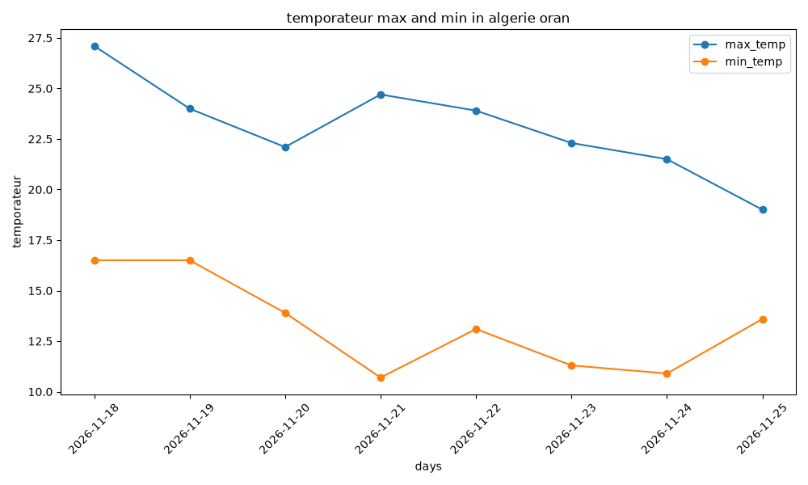

# Weather Report by Coordinates

A Python script that asks for the latitude and longitude of any location, identifies the place name, retrieves the last 7 days of daily temperatures for it, organizes them in a table, and generates a line chart.

## Features

- Accepts any location through latitude and longitude input
- Displays the name of the place that matches the coordinates
- Fetches daily maximum and minimum temperatures from a public weather API
- Builds a structured table with pandas
- Plots a clear line chart (max vs. min temperature)
- Exports results to `CSV` and `PNG` files

## Tech Stack

- Python 3
- `requests` (API calls)
- `pandas` (data handling)
- `matplotlib` (visualization)
- [REPLACE: library or API used to get the place name, for example `geopy`]

## Installation

```bash
git clone https://github.com/YOUR-USERNAME/YOUR-REPO.git
cd YOUR-REPO
pip install -r requirements.txt
```

## Usage

```bash
python weather.py
```

The script asks for the coordinates, for example:

```
Enter latitude: 35.70
Enter longitude: -0.63
```

It then shows the place name, displays the chart, and saves two files:

| File | Description |
|------|-------------|
| `weather.png` | Line chart of daily max and min temperatures |
| `weatherOran/weather.csv` | Daily temperature data in CSV format |

## Example Output



## Data Source

Weather data provided by [Open-Meteo](https://open-meteo.com/) under the [CC BY 4.0](https://creativecommons.org/licenses/by/4.0/) license. No API key is required.

## Possible Improvements

- Validate the input (latitude between -90 and 90, longitude between -180 and 180)
- Add precipitation and wind speed
- Handle network errors (timeout and retries)
- Organize the code into reusable functions

## Author

Nacer Akram Boumous
